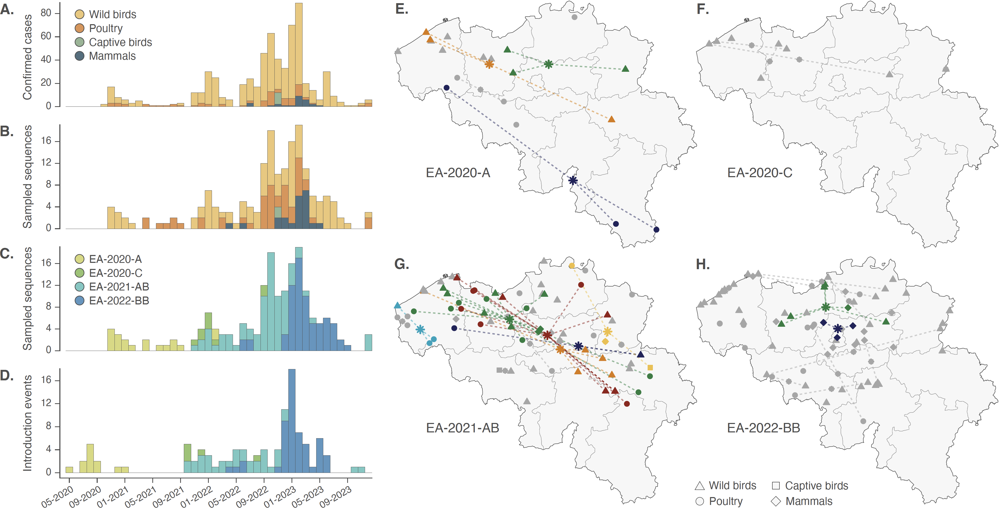
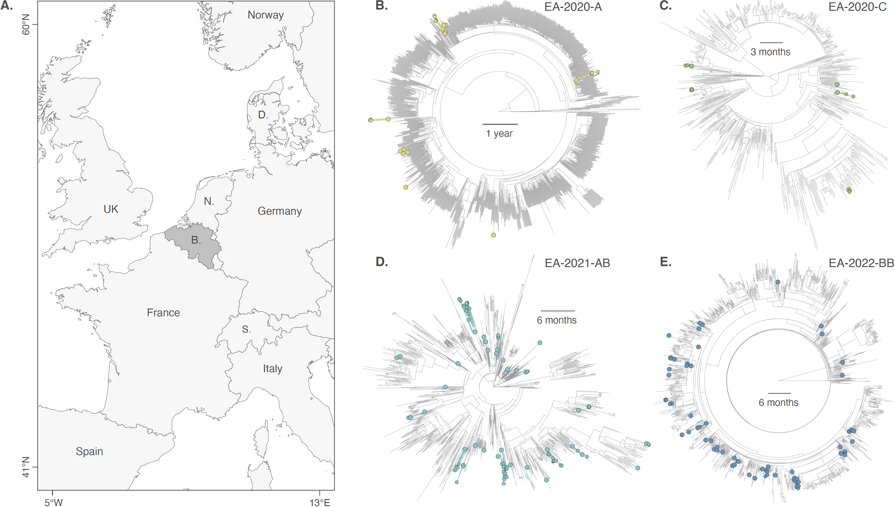
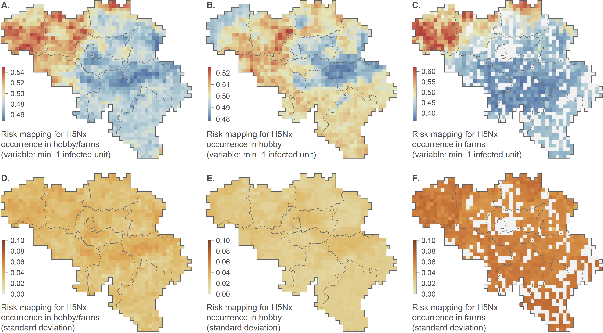

# Dispersal dynamics and risk mapping of H5Nx in Belgium

This repository gathers the input files and scripts related to our study entitled **"National-scale highly pathogenic avian influenza H5 virus dynamics and local outbreak risk: Belgium as a study case"** (Li *et al*., *submitted*). R scripts related to the phylogeographic and risk mapping analyses are available in the respective folders.

Since 2020, highly pathogenic avian influenza (HPAI) H5 viruses of haemagglutinin clade 2.3.4.4b have spread globally across avian and mammalian hosts, with increasing genetic diversity and co-circulation of multiple genotypes in Europe. In this study, we characterise the epidemiological landscape of HPAI H5Nx in Belgium between 2020 and 2023 and investigate the introduction and dispersal dynamics of predominant viral genotypes, alongside ecological niche modelling to assess local outbreak risk at the national scale. To delineate distinct introduction events into the country, discrete phylogeographic analyses of 178 Belgian sequences from multiple host groups were performed, supplemented with publicly available international sequence data. We identified 106 introduction events, largely represented by singleton clusters, suggesting limited sustained viral circulation following introduction. To reconstruct viral dispersal history and dynamics, we subsequently conducted continuous phylogeographic analyses along introduced clades. The spatial distribution of sequences and derived dispersal statistics indicated occasional long-distance dispersal events and a limited tendency for genetically related viruses to cluster geographically. Ecological niche modelling further revealed higher relative outbreak risk for commercial poultry farms in northern Belgium, whereas the predicted risk for hobby units was homogeneous across the country. By analysing genomic and epidemiological data through complementary approaches, we report patterns consistent with control measures contributing to the containment of HPAI spread and highlight the importance of effective national surveillance. Using Belgium as a case study, our findings provide a broader understanding of HPAI epidemiology in national settings facing recurrent threats to poultry production and wild bird populations.

**Figure 1. Temporal and spatial distributions of H5Nx clades introduced into Belgium, 2020-2023.** Clades corresponding to distinct introduction events into the country were inferred by a discrete phylogeographic inference conducted for each of the four predominant H5Nx genotypes detected in Belgium between 2020 and 2023 (EA-2020-A, EA-2020-C, EA-2021-AB, and EA-2022-BB). The histograms show the monthly numbers of H5Nx cases reported in Belgium based on RT-PCR occurrence data (grouped by species type; A), the monthly numbers of H5Nx genomic sequence data collected in Belgium grouped by species type (B) or by genotype (C), and the monthly number of inferred introduced clades (grouped by genotype; D). The maps report the spatial distribution of inferred H5Nx clades introduced into Belgium between 2020 and 2023 (E-H). On these maps, each introduced clade gathering three or more Belgian sequences is shown in colour, with each dot representing the sampling location of an individual genomic sequence. The coloured asterisks denote the geographic centroid of sampling locations within the respective clade, and dotted lines connect each sampling site to its corresponding centroid, illustrating the spatial extent of genetically related sequences collected across the country. Singletons and clades gathering only two genomic sequences are shown in grey, including their centroids and connecting lines. Dot shapes indicate host species groups (wild birds, poultry, captive birds, and mammals). Base maps were derived from the GADM database, version 4.1 (https://gadm.org).

**Figure 2. Discrete phylogeographic inference of H5Nx clades introduced into Belgium, 2020-2023.** The map shows the geographic location of Belgium and surrounding countries in western Europe (A). Circular time-scaled phylogenies (B-E) correspond to maximum clade credibility (MCC) trees obtained from the discrete phylogeographic reconstruction conducted for each of the four predominant H5Nx genotypes detected in Belgium between 2020 and 2023: EA-2020-A (H5N8), EA-2020-C, EA-2021-AB, EA-2022-BB (H5N1). Tip nodes, corresponding to genomic sequences collected in Belgium, are displayed as coloured dots, and coloured internal branches correspond to phylogenetic branches inferred as belonging to a clade introduced into the Belgian territory.

**Figure 3. Risk mapping for H5Nx outbreaks in Belgium.** Risk maps were obtained by averaging the results of 100 independent boosted regression trees (BRT) analyses based on three distinct response variables, i.e. the ecological suitability for local H5Nx circulation leading to at least one detected infected unit (farm or hobby unit) per grid cell (A), at least one detected infected hobby unit per grid cell (B), and at least one detected infected farm unit per grid cell (C). We then also report the corresponding standard deviation associated with the 100 replicated BRT analyses (D-F). See the text for further detail on the ecological niche modelling approach implemented to generate those risk maps as well as Figure S6 for an alternative visualisation of those results including narrower colour scale for maps A-C.
